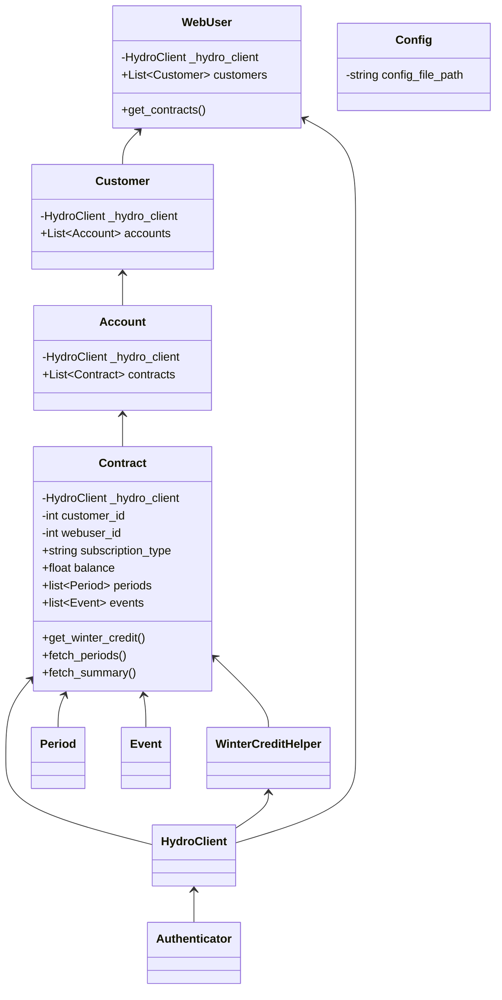

# HydroQC - Hydro Quebec API wrapper


[](https://github.com/hydroqc/hydroqc/actions/workflows/ci.yml)
[](https://codecov.io/gh/hydroqc/hydroqc)
[](https://pypi.org/project/Hydro-Quebec-API-Wrapper/)


**This is a library to use if you want to build your own solution. If you want a user-friendly implementation for your home automation system please use [hydroqc2mqtt](https://gitlab.com/hydroqc/hydroqc2mqtt) which provide a MQTT publisher, docker image and HASS addon.**

This is a package to access some functionalities of Hydro Quebec API that are not documented.

We started a discord server for the project where you can come to discuss and find help with the project on our [#development](https://discord.gg/NWnfdfRZ7T) channel

## Donations

We put a lot of heart and effort in this project, any contribution is greatly appreciated!

[](https://hydroqc.ca/en/donations)

## Tested Rates

Each account, contracts and rates are different and we do our best to integrate all available options. Currently the account combinations listed below are supported and tested automaticaly by our CI/CD pipeline. If your account scenario is not currently tested and listed as **Needed** feel free to reach out to us on our discord [#development](https://discord.gg/NWnfdfRZ7T) channel if you want to volunter for testing. We provide a way to setup CI/CD tests in your own account in a way that keep your account info private to you (more details [here](https://gitlab.com/hydroqc/hydroqc-test-template)). Keep in mind that this process is a bit involved technicaly so it is best if you have some working knowledge with Gitlab.

### Rate D

| Base Rate | Rate Option | Tester | Test result | Last run | Comment |
| - | - | - | - | - | - |
| D | - | @weimdall |  |  | |
| D | - | @mdallaire1 |  |  | |
| D | - | @devzwf |  |  | Hilo |
| D | CPC | @titilambert |  |  | |

#### Flex D (DPC)

| Base Rate | Rate Option  | Tester | Test result | Last run | Comment |
| - | - | - | - | - | - |
| DPC | - | @mdallaire1 |  |  | |

#### Dual Energy (DT)

| Base Rate | Rate Option | Tester | Test result | Last run | Comment |
| - | - | - | - | - | - |
| DT | - | @mdallaire1 |  |  |

#### Rate M

| Base Rate | Rate Option | Tester | Test result | Last run | Comment |
| - | - | - | - | - | - |
| M | - | @hdenergy |  |  | [HD Énergie](https://hd.energy) |
| M | GDP | @hdenergy |  |  | [HD Énergie](https://hd.energy) |

Thanks to [HD Énergie](https://hd.energy) for sponsoring developpement of the Rate M support.

### Other plans
We don't have anyone to test with. Please reach out to us if you have this plan and want to help!

## Adding replay fixtures

Replay fixtures let the regular test suite exercise contract scenarios without
making live Hydro-Québec requests. To capture a new contract type, use a
Hydro-Québec account that has that contract and run the capture command from the
repository root:

```bash
python -m venv .venv  # skip if the virtual environment already exists
.venv/bin/python -m pip install -e . -r test_requirements.txt
.venv/bin/hydroqc-capture
```

Install `capture_requirements.txt` alongside the test dependencies to get the
optional Presidio capture/anonymization dependencies and the small French spaCy
model. These are not runtime dependencies of HydroQC. Keeping these requirements
separate avoids conflicting with test-only packages such as Home Assistant
stubs. In a development environment, run:

```bash
.venv/bin/python -m pip install -e . -r test_requirements.txt
.venv/bin/python -m pip install -r capture_requirements.txt
```

The French model is installed with these packages; capture and fixture
pseudonymization do not download a model at runtime.

The command prompts for the username and, when needed, the password and MFA
code. Once logged in, it lists the contracts available on the account and asks
which one to capture. Pass `--contract <contract-number>` to skip that prompt.

For a contract captured during its winter period, add `--winter-period` so its
fixtures are kept separately from non-winter data:

```bash
.venv/bin/hydroqc-capture --contract <contract-number> --winter-period
```

If the virtual environment is already active, use `hydroqc-capture` instead of
`.venv/bin/hydroqc-capture`. It captures both the web and mobile API profiles
and runs the contract operations discovered by the capture script. At the end it
asks whether to keep the saved sessions (tokens and cookies) for the next
capture or to purge them.

After a successful capture, the script pseudonymizes the responses and installs
them automatically under `tests/fixtures/`:

```text
tests/fixtures/
  DPC_SUMMER/
    capture-01/
      scenario.json
      common/               # this capture's contract-selection responses
        web/
        mobile/
      contract/             # this capture's rate-specific responses
        web/
        mobile/
  D_CPC_SUMMER/
    capture-01/
      ...
```

The outer directory is named from the captured rate and option, joined by an
underscore when an option exists, then suffixed with `_SUMMER` or `_WINTER`
(for example, `D_CPC_SUMMER` or `M_GDP_WINTER`). Each capture has its own
neutral fixture-set name, such as `capture-01`; its `common` selection responses
stay with that set instead of being shared or overwritten by another capture.
After capturing, the command lists existing sets and lets you replace one (with
a separate confirmation) or create a new one. New names must be neutral and
must not contain personal or contract-identifying information.

The same choice can be made explicitly on the command line. Give a new name to
add a separate set, or add `--replace-fixture` to replace that named set:

```bash
.venv/bin/hydroqc-capture --fixture-name capture-02
.venv/bin/hydroqc-capture --fixture-name capture-01 --replace-fixture
```

An existing set is never replaced implicitly. The `--winter-period` flag selects
the `_WINTER` suffix and records
`"winter_period": true` in its `scenario.json`; without the flag, the scenario
gets a `_SUMMER` suffix and the field is `false`. This works with any rate and
option, including G and M: for example, `G_SUMMER` / `G_WINTER` or
`M_GDP_SUMMER` / `M_GDP_WINTER`. The separate folders keep each season's
responses apart.

The capture pseudonymizes customer, account, contract, location, and contact
details. It preserves consumption readings and their dates, so these are
pseudonymized fixtures—not fully anonymized data—and should still be handled
carefully. Monetary amounts are synthesized. OAuth token responses are not
installed as fixtures. On success, the sensitive raw capture is deleted. Do
not use `--keep-raw` for a normal fixture contribution, and never commit or
share a raw capture. If capture fails, it prints the location of the raw files
for local diagnosis; remove them securely when finished.

Add one full scenario test for each contract type in `tests/scenarios/`, using
`tests/scenarios/test_d_cpc.py` as the template. Parameterize the test over
`web` and `mobile`, load the selected fixture set's `common` responses followed
by its `contract` responses, and replay the complete authenticated hierarchy
through `run_webuser_contract_scenario` (`WebUser → Customer → Account →
Contract`). Assert the expected rate and option, and assert that the replay
transport consumed every recorded response. If a contract type has multiple
fixture sets, the scenario test discovers and replays each set. Contract
fixtures without the `infoCompte` responses needed for the authenticated
hierarchy must be recaptured before they can run this full scenario.

Run the new scenario without network access, then run all safe local tests:

```bash
.venv/bin/python -m pytest -q tests/scenarios/test_<scenario>.py
.venv/bin/python -m pytest -q tests/unit tests/scenarios
```

## Documentation

### Code documentation

[https://hydroqc.readthedocs.io/](https://hydroqc.readthedocs.io/)

### Architecture / concepts

If you need more information about the usage and current integrations of the library please see our website [https://hydroqc.ca](https://hydroqc.ca)

## E-mail verification (MFA)

Hydro-Québec can ask for a one-time code sent by e-mail after the password round
trip. `login()` returns a `LoginStatus` instead of a plain boolean:

```python
from hydroqc.consts import LoginStatus
from hydroqc.error import HydroQcMFAInvalidCodeError

status = await webuser.login()
while status is LoginStatus.MFA_REQUIRED:
    code = input("Verification code (empty = send a new one): ")
    if not code.strip():
        await webuser.request_mfa_code()
        continue
    try:
        status = await webuser.submit_mfa_code(code)
    except HydroQcMFAInvalidCodeError:
        print("Code refused, try again.")

if status is not LoginStatus.SUCCESS:
    raise RuntimeError("Login failed")
```

`bool(status)` is only true for `LoginStatus.SUCCESS`, so existing code using
`if await webuser.login():` keeps working. The code is requested automatically
when the step is detected; `request_mfa_code()` sends a new one. The
verification step expires after a few minutes (3 minutes on the current
portal): `HydroQcMFAExpiredError` means the login has to be restarted.

A silent background login cannot ask for a code and raises
`HydroQcMFARequiredError` instead of failing quietly.

### Reusing a session

`export_session_state()` returns the OAuth tokens plus the Azure AD B2C cookies;
`import_session_state()` restores them. Persisting that state lets a later run
skip the password (and a new verification code) while the refresh token or the
single sign-on cookie is still valid. The current portal issues 15-minute access
tokens and a 24-hour refresh token, so the stored session is normally reusable
for about a day; once the refresh token and the single sign-on cookie are both
refused, a new interactive login (and a new code) is required:

```python
state = webuser.export_session_state()   # store it somewhere safe
# ... next run ...
webuser = WebUser(username, password, verify_ssl=True)
webuser.import_session_state(state)
if await webuser.try_silent_login() is not LoginStatus.SUCCESS:
    await webuser.login()
```

## Goal

Make it easy to fetch and manipulate data from Hydro-Quebec, especially the winter credit periods

## Example folder

An example script that extracts the data available from Hydro-Quebec is available in the examples folder.

### Basic setup

This uses python 3.10

1. Clone the repo

   ```bash
   git clone https://github.com/hydroqc/hydroqc.git
   ```

2. Create a virtual-env

   ```bash
   python -m venv env
   . env/bin/activate
   pip install --editable .
   ```

3. Enter your hydro account credentials in the examples/hydro.py file (line 6)

4. Run

   ```bash
   examples/hydro.py
   ```

## TODO

[https://gitlab.com/groups/hydroqc/-/issues](https://gitlab.com/groups/hydroqc/-/issues)

## Targeted architecture (might change in the future)


